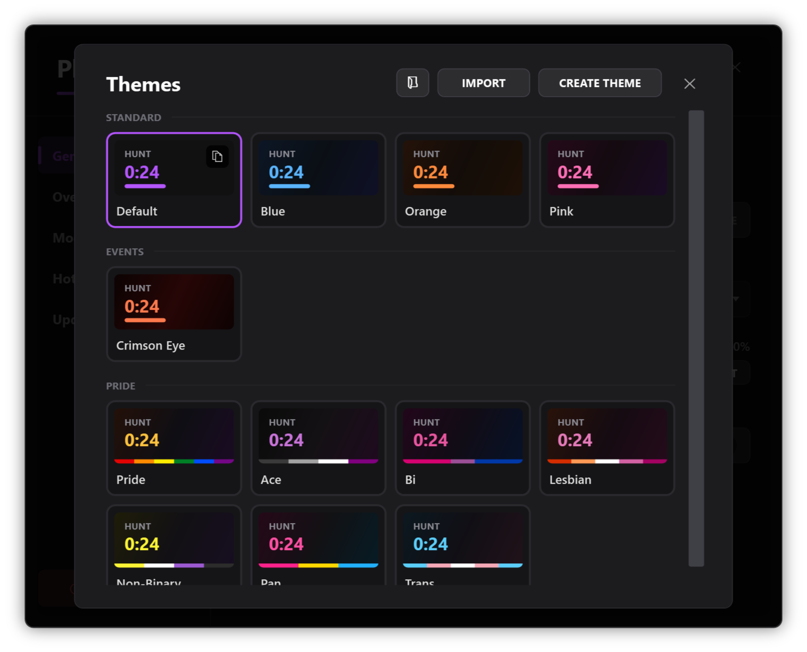
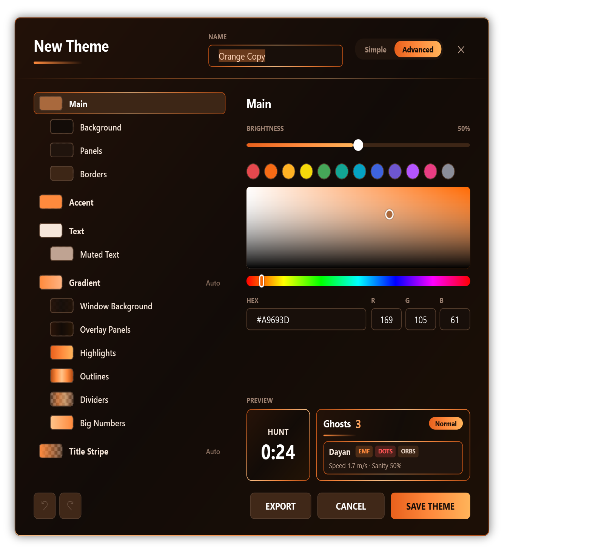
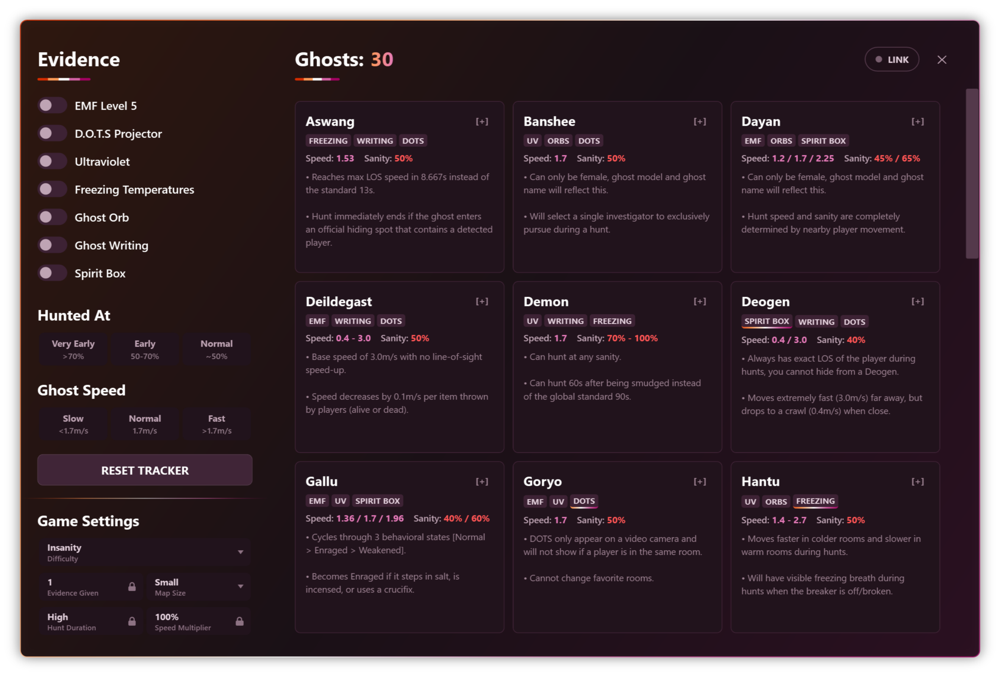
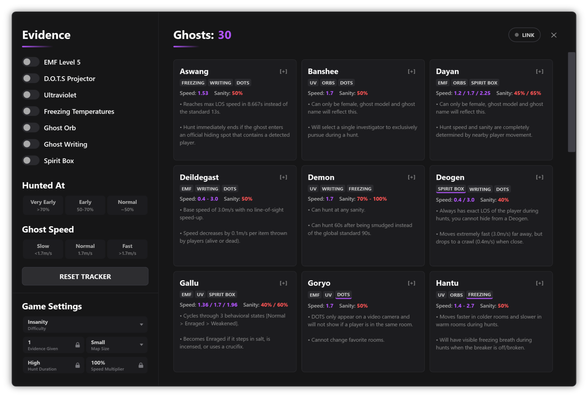
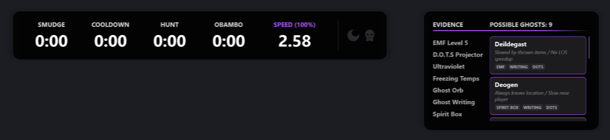
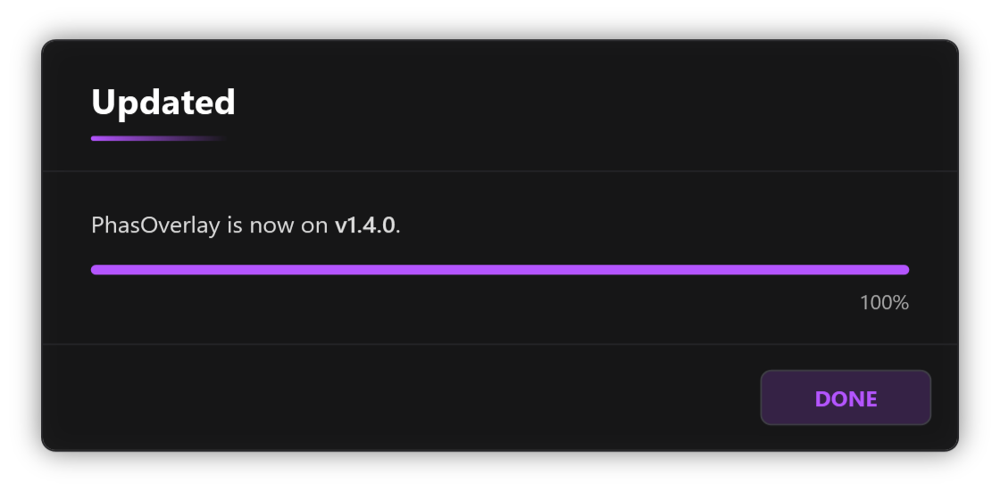

Hi, today I will give you a preview at some of the cool things coming in 1.4.0 to Desktop. Web changes will be covered in another blog posts as both deserve their spotlight. Let's get into it!

# Themes
In 1.4.0, you can now customise PhasOverlay with themes! At launch, it will ship with 12 themes. This ranges from standard themes, event orientated themes and pride themes! 

Themes change how PhasOverlay looks and feels to use, each handcrafted with love by me! If no themes here interest you, you can also just create your own custom theme! Using the Theme Editor, you can customise everything to your liking & when you're done, save or share your theme! 

You have full control over the colours of your theme, and your custom themes remain saved forever! No update will wipe your custom themes, but you may see new themes show up as time goes on. Christmas is on it's way..

Keep in mind, everything is subject to change a little, but generally it will look similar to this when it comes out. As you may have noticed, the evidence window looks a bit different.. which takes us perfectly into the next section! 

# Improved Evidence Window
As you can see, the game settings have been relocated from the top right submenu to the bottom left. This was done to make game settings more accessible, as well as make it so you won't forget your current settings. This was done because typically, if you wanted to change your settings you would have to click two buttons to change it which overtime would get repetitive, and again, since it starts collapsed into a submenu, you could easily forget to change your settings which could lead to inaccurate timers/evidence. As well as that, the "Hunted" was changed to "Hunted At" with a section removed because all hosts can hunt late, so that's no longer an option supported by the overlay. It's also changed to Hunted At to make it more clear what it actually does. The ghosts remaining had a little style change as well! 

This is just one half to the intended changes to the Evidence Window. Coming with 1.4.0, there will be a new mode called No Evidence Mode, which is meant to assist you when you do no evidence by giving you ways to rule out ghosts by just answering simple yes or no questions. It doesn't take away from the fact you need pro knowledge to do no evidence, but it helps! This is all part of a larger push to improve the Evidence Window, with intentions to eventually start adding gifs showing ghost behaviour, blink patterns, etc. More on that at some point in the future! 

# Improved Tap To Speed

Tap To Speed will be receiving some improvements in the sense it will now be able to factor in ghost LOS speedup. As it stands, during a hunt if you tap to the ghost chasing you while it speeds up, it will end up ruling out the actual ghost. With this update, you will see a "LOS" indicator in the possible ghosts window that show if the speed matches a ghost speeding up with LOS. Although this will be a helpful feature, I still recommend exclusively tying to tap to the ghost speed when it can't see anyone, as this will always yield the most accurate results.

# Auto Updating

In 1.4.0, the new main option to install PhasOverlay Desktop will be an installer rather than a zipped folder with an .exe (it'll still be an option for those who prefer it). The purpose of this installer is to automatically set up the overlay without the need for unzipping, put it in your start menu & for future updates, it will notify you of the new update and ask you to download. Previously if you clicked update, you had to do it manually. Now, when you click update the overlay will automatically install the update and apply it to your PhasOverlay! 

This isn't everything coming with 1.4.0, but it's a good chunk of the update. The purpose of 1.4.0 is to fix issues, make the overlay better to use for everyone as well as adding features that make sense. As to not spoil all coming, I will not show everything coming. So don't worry, there's a looot coming. I expect the update to come out at some point in November, but I promise the wait will be worth it. PhasOverlay 1.4.0 will be the best Phasmphobia overlay you can get. See you soon to talk about Web! 